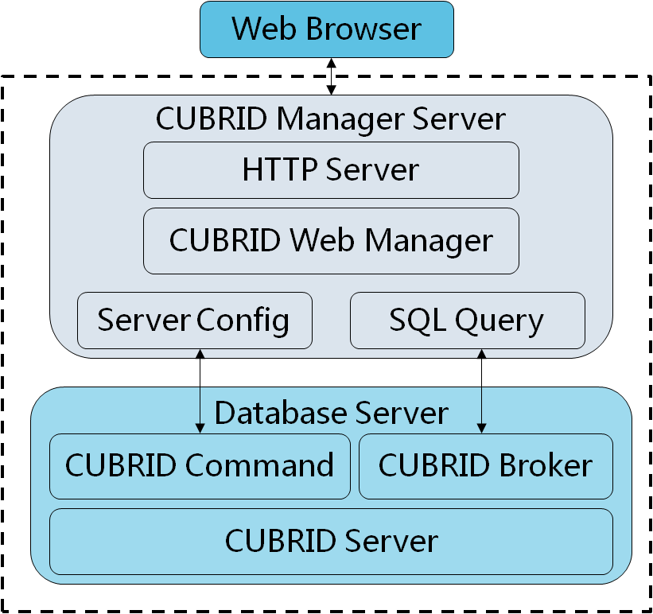

# CUBRID Manager Server API Manual

## Overview

The CUBRID Manager Server (CMS) HTTP Interface is an interface that exists between the CUBRID manager server and the application client, through which a web-based application client can access the CUBRID manager server. The CUBRID manager server delivers the request received from an application client to the CUBRID, and transfers the execution result to the client.

## System Architecture

CMS is a manager tools for CUBRID including database configure, monitor, SQL query. As a component of the CUBRID Database Management System, CMS provides a web-based tool that allows users to remotely manage the database and the Broker.


CMS Architecture

## Writing HTTP Application Program

CMS http interface is REST-like interface, client can POST JSON-format request to url `http://cms_ip:cms_port/cm_api`, and receive the execution result.

The basic steps used for writing programs are as follows. First client must log in CMS with DBMT user name and password. If client login success, CMS will return a token which will be used in following request. The steps are implemented in example codes.

Example in Python Request:

```
import http.client,urllib.parse  

body = "{\"task\":\"login\",\  
\"id\":\"admin\",\  
\"password\":\"admin\",\  
\"clientver\":\"8.4\"}"  

headers = {"Accept": "text/plain;charset=utf-8"}  
conn = http.client.HTTPConnection("localhost", 8003)  
conn.request("POST", "/cm_api", body, headers)  
r = conn.getresponse()  
print (r.read())
```

The client will receive response in JSON-format. If success, `status` is `success`, otherwise `failure` and `note` will give error reason. The data `token` will be used in following request.

The token is an opaque random value of 256 hexadecimal characters; it carries no information and a client must not interpret it. See [Session](#session).

```
{
	   "note" : "none",
	   "status" : "success",
 	   "task" : "authenticate",
	   "token" : "3f9a...(256 hexadecimal characters)...c21e"
}
```

## Interface Permission

Every task requires one of the permissions below, or only a login. The permission a task requires is written at the top of its document ("Permissions required to run this task") and in the tables under [CMS Interfaces](#cms-interfaces). Both are generated from the task tables of the server source by `tools/gen_task_authority.py`.

| **Permission Name** | **Permission Description** |
| --- | --- |
| DBC | Database Creation - create, delete, rename and copy databases |
| DBO | Database Operation - use database utilities and modify configuration files |
| BRK | Broker - start, stop and configure brokers (including shard brokers) |
| MON | Monitoring - change monitoring settings and status templates |
| JOB | Automation - set up automated jobs |
| VAR | Show Variable - no task requires it at present |
| ADMIN | Administrator - runs every task, including CMS user management |

- **Several permissions listed** ("one of DBC, DBO"): having any one of them is enough.
- **none (any logged-in user)**: the task needs only a valid token; read-only tasks are of this kind.
- **ADMIN**: a user with ADMIN runs every task, whatever the task lists. The user named `admin` always has ADMIN.
- A user without the permission gets `"status":"failure"` with the note `The user don't have authority to execute the task: <task>`.

### Permissions of a CMS user

The permissions of a CMS user are read from `cmdb.pass` on every request:

- A user created or changed by `adddbmtuser_new`/`updatedbmtuser_new` has a `user_auth` entry, and it is used as it is - even when it holds no permission at all (such a user can run only "any logged-in user" tasks).
- A user created by `adddbmtuser`/`updatedbmtuser` has no `user_auth` entry. Its permissions come from the three authorities of CUBRID Manager:

| **Entry** | **Value** | **Permission** |
| --- | --- | --- |
| dbcreate | admin | DBC |
| casauth (unicas) | admin | BRK |
| statusmonitorauth | admin | MON |
| any of them | monitor, none | (none) |
| - | - | DBO and JOB are always given |

- When `updatedbmtuser` changes one of the three authorities of a user that also has `user_auth`, the matching permission in `user_auth` is changed with it; the other permissions are kept.

### Rules beyond the permission

- CMS user management (`adddbmtuser`, `updatedbmtuser`, `deletedbmtuser`, `adddbmtuser_new`, `updatedbmtuser_new`) requires ADMIN.
- `setdbmtpasswd`: every user can change its own password; only ADMIN can change another user's.
- No response carries a password: neither CMS user passwords (`getdbmtuserinfo`) nor the mail password (`getautojobconf`).

## Session

- `login` creates a session and returns its token. Send the token with every following request.
- A user can hold several sessions at once (one per login). `max_sessions_per_user` in `cm.conf` limits them (1 to 64, default 16); when a login would exceed it, the least recently used session of that user is closed. Set it to 1 for one session per user.
- A session expires after `token_active_time` seconds (default 7200) without a request. It must be an integer from 1 to 2147483647; any other value is logged and 7200 is used.
- `logout` closes only its own session. Deleting a CMS user closes all of its sessions. Changing a password keeps the existing sessions; the new password applies from the next login.
- The DB login given to `dbmtuserlogin` is kept in that session only, in memory, and is used for later requests of the same session that name the database and give no `dbuser`/`dbpasswd` of their own. Other sessions, other users and the disk never see it.

### Reserved keys

Keys starting with `_` (`_ID`, `_DBID`, `_DBPASSWD`, ...) are reserved for values the server sets. A client must not send them: CMS removes them from a request at every nesting level before processing it. Send the DB login as `dbuser`/`dbpasswd`. (For compatibility, `loaddb` and `killtransaction` still take `_DBID`/`_DBPASSWD` for one more release; see their documents.)

## File Access

Tasks that take a file or directory path accept only paths under `$CUBRID` and `$CUBRID_DATABASES`, and in addition:

- These files are never read or written through a task, whatever the user's permission: `conf/cm.pass`, `conf/cmdb.pass`, `log/manager/conlist`, `conf/autojobs.conf`, `conf/autoexecquery.conf`, and the TLS key and certificate of CMS (`conf/cm_ssl_cert.key`, `conf/cm_ssl_cert.crt`). A request for one fails with `access to a protected file is not allowed`.
- A task that copies or deletes a whole directory (`copyfolder`, `deletefolder`) refuses a directory that holds one of those files (`the directory contains a protected file`).
- Tasks that write, empty or delete a file (`writeandsaveconf`, `writeprivatedata`, `resetlog`, `removelog`, the destination of `copyfolder`) and `deletefolder` refuse `$CUBRID/bin` and paths under it (`writing under $CUBRID/bin is not allowed`).

## Asynchronous Task Execution

Some tasks can be run in the background instead of blocking until they finish; see [Asynchronous Task Execution](async_readme.md) for the list of supported tasks, how to request async mode, and the related `cm.conf` settings.

## Paths in Request Samples

Some request samples in the interface documents write a path as `$CUBRID/...` or `$CUBRID_DATABASES/...`. These stand for the CUBRID installation directory and the databases directory of the host where CMS runs; they are notation for the reader. Unless an interface document says otherwise, CMS uses a path in a request as it is, without expanding environment variables, so a client has to send the actual absolute path instead.

For example, when CUBRID is installed in `/home/cubrid/CUBRID`, a sample written as

```
  "backupdir": "$CUBRID_DATABASES/alatestdb/backup",
```

is sent as

```
  "backupdir": "/home/cubrid/CUBRID/databases/alatestdb/backup",
```

## CMS Interfaces

CMS Interfaces are composed by JSON and is used for communication between CMS and Cubrid Manager.

The Permission column is generated from the task tables (see [Interface Permission](#interface-permission)); where several permissions are listed, any one of them is enough.

### Broker

| **Interface Name** | **Connection Type** | **Permission** | **Support Version** |
| --- | --- | --- | --- |
| [startbroker](startbroker.md) | socket, http | DBC, DBO, BRK |
| [stopbroker](stopbroker.md) | socket, http | DBC, DBO, BRK |
| [getaddbrokerinfo](getaddbrokerinfo.md) | socket, http | any logged-in user |
| [deletebroker](deletebroker.md) | socket, http | DBC, DBO, BRK |
| [getbrokerstatus](getbrokerstatus.md) | socket, http | any logged-in user |
| [broker_setparam](broker_setparam.md) | socket, http | DBC, DBO, BRK |
| [broker_start](broker_start.md) | socket, http | DBC, DBO, BRK |
| [broker_stop](broker_stop.md) | socket, http | DBC, DBO, BRK |
| [broker_restart](broker_restart.md) | socket, http | DBC, DBO, BRK |
| [getbrokerdiagdata](getbrokerdiagdata.md) | socket, http | any logged-in user |
| [getbrokersinfo](getbrokersinfo.md) | socket, http | any logged-in user |

### DB

| **Interface Name** | **Connection Type** | **Permission** | **Support Version** |
| --- | --- | --- | --- |
| [createdb](createdb.md) | socket, http | DBC |
| [deletedb](deletedb.md) | socket, http | DBC |
| [renamedb](renamedb.md) | socket, http | DBC |
| [startdb](startdb.md) | socket, http | DBC, DBO |
| [stopdb](stopdb.md) | socket, http | DBC, DBO |
| [dbspaceinfo](dbspaceinfo.md) | socket, http | any logged-in user |
| [copydb](copydb.md) | socket, http | DBC |
| [optimizedb](optimizedb.md) | socket, http | DBC, DBO |
| [checkdb](checkdb.md) | socket, http | DBC, DBO |
| [compactdb](compactdb.md) | socket, http | DBC, DBO |
| [backupdb](backupdb.md) | socket, http | DBC, DBO |
| [unloaddb](unloaddb.md) | socket, http | DBC, DBO |
| [loaddb](loaddb.md) | socket, http | DBC, DBO |
| [lockdb](lockdb.md) | socket, http | any logged-in user |
| [restoredb](restoredb.md) | socket, http | DBC, DBO |
| [getdbsize](getdbsize.md) | socket, http | any logged-in user |
| [startinfo](startinfo.md) | socket, http | any logged-in user |
| [getbackuplist](getbackuplist.md) | socket, http | any logged-in user |
| [getdbprocstat](getdbprocstat.md) | socket, http | any logged-in user |
| [changemode](changemode.md) | socket, http | DBC, DBO |
| [getdbmode](getdbmode.md) | socket, http | any logged-in user |
| [addvoldb](addvoldb.md) | socket, http | DBC, DBO |
| [class](class.md) | socket, http | any logged-in user |
| [classinfo](classinfo.md) | socket, http | any logged-in user |
| [start_statdump](start_statdump.md) | socket, http | DBC, DBO, MON |
| [stop_statdump](stop_statdump.md) | socket, http | DBC, DBO, MON |
| [unloadinfo](unloadinfo.md) | socket, http | any logged-in user |
| [dbspace](dbspace.md) | socket, http | any logged-in user |

### DB User

| **Interface Name** | **Connection Type** | **Permission** | **Support Version** |
| --- | --- | --- | --- |
| [userinfo](userinfo.md) | socket, http | any logged-in user |
| [createuser](createuser.md) | socket, http | DBO |
| [deleteuser](deleteuser.md) | socket, http | DBO |
| [updateuser](updateuser.md) | socket, http | DBO |
| [userverify](userverify.md) | socket, http | any logged-in user |

### CM User

| **Interface Name**| **Connection Type** | **Permission** | **Support Version** |
| --- | --- | --- | --- |
| [getdbmtuserinfo](getdbmtuserinfo.md) | socket, http | any logged-in user |
| [deletedbmtuser](deletedbmtuser.md) | socket, http | ADMIN |
| [updatedbmtuser](updatedbmtuser.md) | socket, http | ADMIN |
| [setdbmtpasswd](setdbmtpasswd.md) | socket, http | any logged-in user |
| [adddbmtuser](adddbmtuser.md) | socket, http | ADMIN |
| [getaddvolstatus](getaddvolstatus.md) | socket, http | any logged-in user |
| [dbmtuserlogin](dbmtuserlogin.md) | socket, http | any logged-in user |

### Transaction

| **Interface Name** | **Connection Type** | **Permission** | **Support Version** |
| --- | --- | --- | --- |
| [gettransactioninfo](gettransactioninfo.md) | socket, http | any logged-in user |
| [killtransaction](killtransaction.md) | socket, http | DBC, DBO, MON |

### Trigger

| **Interface Name** | **Connection Type** | **Permission** | **Support Version** |
| --- | --- | --- | --- |
| [addtrigger](addtrigger.md) | socket, http | DBC, DBO |
| [altertrigger](altertrigger.md) | socket, http | DBC, DBO |
| [droptrigger](droptrigger.md) | socket, http | DBC, DBO |
| [gettriggerinfo](gettriggerinfo.md) | socket, http | any logged-in user |

### Automation

| **Interface Name** | **Connection Type** | **Permission** | **Support Version** |
| --- | --- | --- | --- |
| [backupdbinfo](backupdbinfo.md) | socket, http | any logged-in user |
| [getbackupinfo](getbackupinfo.md) | socket, http | any logged-in user |
| [addbackupinfo](addbackupinfo.md) | socket, http | DBC, DBO, JOB |
| [deletebackupinfo](deletebackupinfo.md) | socket, http | DBC, DBO, JOB |
| [setbackupinfo](setbackupinfo.md) | socket, http | DBC, DBO, JOB |
| [getautoaddvol](getautoaddvol.md) | socket, http | any logged-in user |
| [setautoaddvol](setautoaddvol.md) | socket, http | DBC, DBO |
| [getautoexecquery](getautoexecquery.md) | socket, http | any logged-in user |
| [setautoexecquery](setautoexecquery.md) | socket, http | DBC, DBO, JOB |

### HA

| **Interface Name** | **Connection Type** | **Permission** | **Support Version** |
| --- | --- | --- | --- |
| [heartbeatlist](heartbeatlist.md) | socket, http | any logged-in user |
| [ha_reload](ha_reload.md) | socket, http | DBC, DBO |
| [ha_status](ha_status.md) | socket, http | any logged-in user |
| [ha_start](ha_start.md) | socket, http | DBC, DBO |
| [ha_stop](ha_stop.md) | socket, http | DBC, DBO |
| [gethaapplyinfo](gethaapplyinfo.md) | http | any logged-in user |

### Monitoring

| **Interface Name** | **Connection Type** | **Permission** | **Support Version** |
| --- | --- | --- | --- |
| [get_mon_interval](get_mon_interval.md) | http | any logged-in user |
| [set_mon_interval](set_mon_interval.md) | http | ADMIN |
| [get_mon_statistic](get_mon_statistic.md) | http | any logged-in user |
| [getserverstatus](getserverstatus.md) | http | ADMIN |
| [getserverinfo](getserverinfo.md) | http | any logged-in user |
| [gettaskstatus](gettaskstatus.md) | http | the user who started the job |
| [monitorprocess](monitorprocess.md) | socket, http | any logged-in user |
| [gethoststat](gethoststat.md) | socket, http | any logged-in user |
| [addstatustemplate](addstatustemplate.md) | socket, http | DBC, DBO, MON |
| [updatestatustemplate](updatestatustemplate.md) | socket, http | DBC, DBO, MON |
| removestatustemplate | socket, http | DBC, DBO, MON |

### Log

| **Interface Name** | **Connection Type** | **Permission** | **Support Version** |
| --- | --- | --- | --- |
| [getloginfo](getloginfo.md) | socket, http | any logged-in user |
| [viewlog/viewlog2](viewlogviewlog2.md) | socket, http | any logged-in user |
| [loadaccesslog](loadaccesslog.md) | socket, http | any logged-in user |
| [getautobackupdberrlog](getautobackupdberrlog.md) | socket, http | any logged-in user |
| [getautoexecqueryerrlog](getautoexecqueryerrlog.md) | socket, http | any logged-in user |
| [getautoaddvollog](getautoaddvollog.md) | socket, http | any logged-in user |
| [getadminloginfo](getadminloginfo.md) | socket, http | ADMIN |
| [getlogfileinfo](getlogfileinfo.md) | socket, http | any logged-in user |
| [analyzecaslog](analyzecaslog.md) | socket, http | any logged-in user |
| [getcaslogtopresult](getcaslogtopresult.md) | socket, http | any logged-in user |
| resetlog | socket, http | DBC, DBO |
| removelog | socket, http | DBC, DBO |
| [errortrace](errortrace.md) | socket, http | any logged-in user |

### Shard

| **Interface Name** | **Connection Type** | **Permission** | **Support Version** |
| --- | --- | --- | --- |
| [getshardinfo](getshardinfo.md) | socket, http | any logged-in user |

### Others

| **Interface Name** | **Connection Type** | **Permission** | **Support Version** |
| --- | --- | --- | --- |
| [setsysparam](setsysparam.md) | socket, http | DBC, DBO |
| [getallsysparam](getallsysparam.md) | socket, http | any logged-in user |
| [plandump](plandump.md) | socket, http | any logged-in user |
| [paramdump](paramdump.md) | socket, http | any logged-in user |
| [statdump](statdump.md) | socket, http | any logged-in user |
| [backupvolinfo](backupvolinfo.md) | socket, http | any logged-in user |
| [getdiagdata](getdiagdata.md) | socket, http | any logged-in user |
| [getstandbyserverstat](getstandbyserverstat.md) | socket, http | any logged-in user |
| [login](login.md) | socket, http | no login required |
| [logout](logout.md) | socket, http | any logged-in user |
| [getcmsenv](getcmsenv.md) | socket, http | no login required |
| [getenv](getenv.md) | socket, http | any logged-in user |
| [shard_start](shard_start.md) | socket, http | DBC, DBO, BRK |
| [shard_stop](shard_stop.md) | socket, http | DBC, DBO, BRK |

<!-- generated by tools/gen_task_authority.py: tasks without a document -->

### Other tasks

These tasks are not listed in the sections above; most of them have no
document of their own yet.

| **Interface Name** | **Connection Type** | **Permission** |
| --- | --- | --- |
| adddbmtuser_new | http | ADMIN |
| automail | http | DBC, DBO, MON |
| autoupdate | socket, http | ADMIN |
| broker_changer | socket, http | DBC, DBO, BRK |
| [checkdir](checkdir.md) | socket, http | any logged-in user |
| [checkfile](checkfile.md) | socket, http | any logged-in user |
| copyfolder | socket, http | DBC, DBO |
| deletefolder | socket, http | DBC, DBO |
| execautostart | http | DBC, DBO |
| [executecasrunner](executecasrunner.md) | socket, http | DBC, DBO, BRK, MON |
| [generatecert](generatecert.md) | socket, http | ADMIN |
| getaccesslogfiles | socket, http | any logged-in user |
| [getautojobconf](getautojobconf.md) | http | any logged-in user |
| getautostart | http | any logged-in user |
| getbrokerlog | http | any logged-in user |
| getdberrorlog | http | any logged-in user |
| [getdbmtuserinfo_new](getdbmtuserinfo_new.md) | http | DBC, DBO |
| getenvvarbyname | socket, http | any logged-in user |
| geterrorlogfiles | socket, http | any logged-in user |
| getfiletotallinenum | socket, http | any logged-in user |
| getfolderswithkeyword | socket, http | any logged-in user |
| getinitbrokersinfo | socket, http | any logged-in user |
| getprocstat | http | any logged-in user |
| getshardstatus | socket, http | any logged-in user |
| getstatustemplate | socket, http | any logged-in user |
| getsysdiskinfo | http | any logged-in user |
| ha_applylogdb | socket, http | DBC, DBO |
| ha_copylogdb | socket, http | DBC, DBO |
| isupdatesuccess | socket, http | ADMIN |
| keepalive | socket, http | any logged-in user |
| kill_process | socket, http | DBC, DBO |
| list_dir | socket, http | any logged-in user |
| readprivatedata | http | DBC, DBO, BRK |
| removecasrunnertmpfile | socket, http | DBC, DBO, BRK, MON |
| removefiles | socket, http | DBC, DBO |
| [rolechange](rolechange.md) | socket, http | DBC, DBO |
| runscript | socket, http | ADMIN |
| runsqlstatement | socket, http | DBC, DBO |
| sendmail | http | DBC, DBO, MON |
| [setautojobconf](setautojobconf.md) | http | DBC, DBO, JOB |
| setautostart | http | DBC, DBO, JOB |
| setloglevel | http | DBC, DBO, MON |
| updateattribute | socket, http | DBC, DBO |
| updatedbmtuser_new | http | ADMIN |
| writeandsaveconf | socket, http | DBC, DBO |
| writeprivatedata | http | DBC, DBO, BRK |

<!-- end of generated table -->
